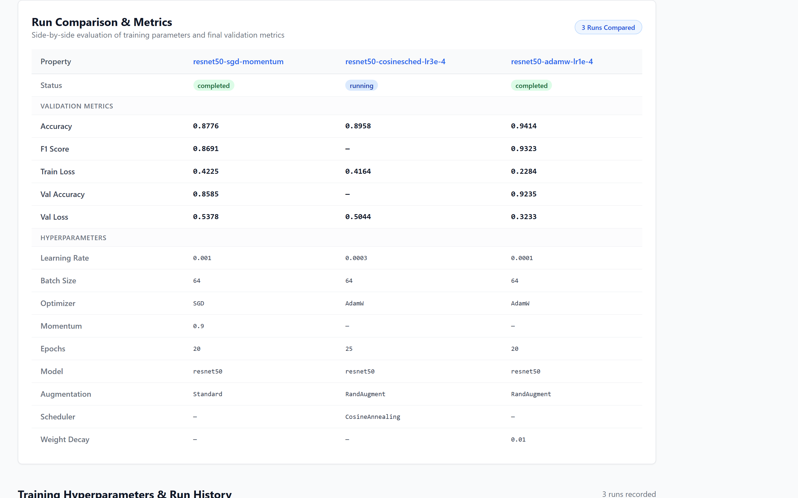
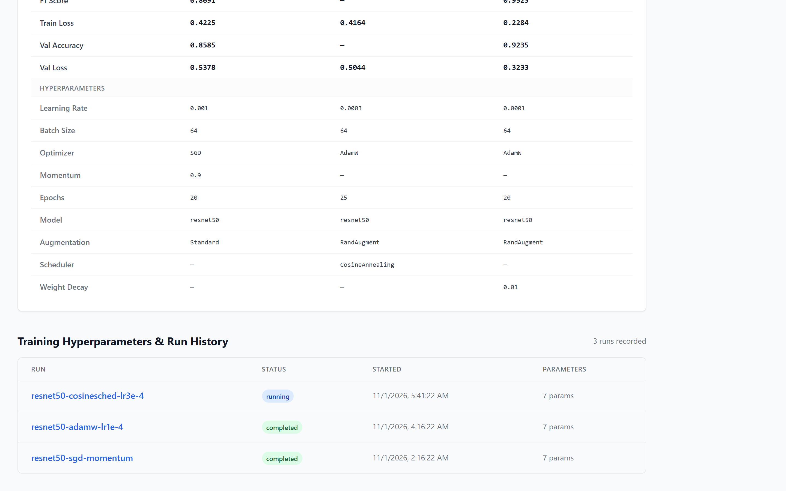
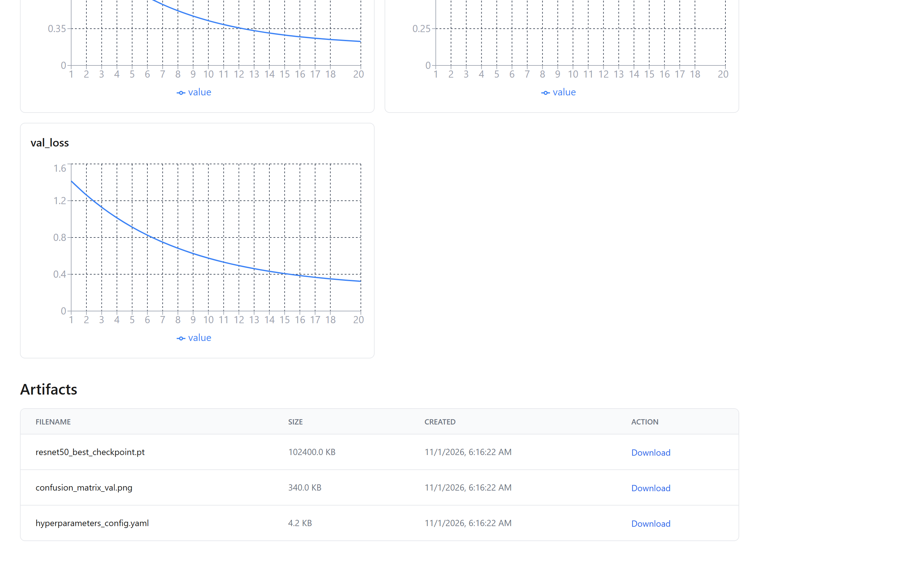
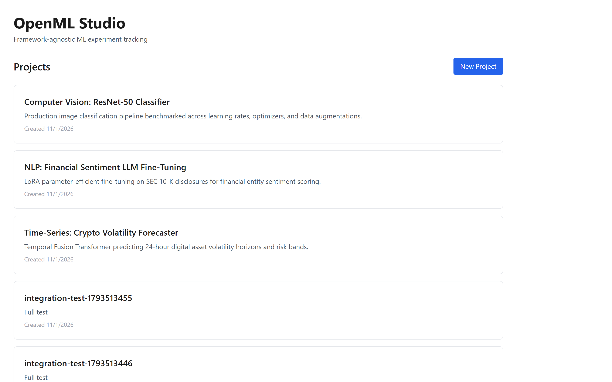

# OpenML Studio

Open-source MLOps experiment tracker. Framework-agnostic.

Repository: https://github.com/0xyz-exe/openml-studio

## Screenshots

### 1. Experiment Run Comparison & Metrics
Tampilan komparasi eksperimen pelatihan machine learning berdampingan (side-by-side) yang membandingkan metrik validasi akhir (akurasi, F1-score, train loss, validation accuracy, dan validation loss) serta konfigurasi hyperparameter (learning rate, ukuran batch, optimizer AdamW/SGD, scheduler, bobot decay, dan teknik augmentasi) secara komprehensif antar run model:


### 2. Training Hyperparameters & Run History
Tabel riwayat eksekusi training model yang mencatat status siklus pelatihan (running, completed, failed), waktu mulai komputasi, jumlah hyperparameter yang terkonfigurasi, nama dataset rujukan, serta tautan cepat ke visualisasi grafik detail setiap eksperimen:


### 3. Model Artifacts & Metric Visualizations
Visualisasi metrik model real-time menggunakan grafik garis interaktif Recharts untuk memantau konvergensi loss dan peningkatan akurasi per epoch, dilengkapi katalog penyimpanan berkas artefak model (checkpoint bobot PyTorch `.pt`, matriks konfusi, dan konfigurasi YAML) dengan ukuran berkas dan fitur unduh langsung:


### 4. Project Overview & Active Experiments
Dasbor utama OpenML Studio yang menampilkan daftar proyek machine learning aktif (Computer Vision ResNet-50 Classifier, NLP Financial Sentiment LLM, dan Time-Series Volatility Forecaster) dengan deskripsi teknis, tanggal pembuatan proyek, serta navigasi terstruktur menuju kelompok eksperimen:


## Features (MVP)

- Track experiments, runs, metrics, hyperparameters
- Python SDK for any training script
- Compare runs side-by-side
- Local storage (SQLite + filesystem)
- Web UI for visualization

## Quick Start

Start the backend and frontend in separate terminals.

### Backend

On Windows PowerShell:

```powershell
cd backend
python -m venv venv
.\venv\Scripts\Activate.ps1
pip install -r requirements.txt
python init_db.py
python -m uvicorn app.main:app --reload --port 8001
```

On macOS/Linux:

```bash
cd backend
python3 -m venv venv
source venv/bin/activate
pip install -r requirements.txt
python init_db.py
python -m uvicorn app.main:app --reload --port 8001
```

The API is available at `http://localhost:8001`.

### Frontend

In a second terminal:

```bash
cd frontend
npm install
npm run dev -- -p 3001
```

The web UI is available at `http://localhost:3001`. Do not run `npm run build`
at the same time as `npm run dev`; both commands use the `.next` build directory.

## Example Usage

```python
from openml_studio import Client

client = Client("http://localhost:8001")

with client.start_run(project="my-project", experiment="baseline") as run:
    run.log_params({"lr": 0.001, "epochs": 10})
    
    for epoch in range(10):
        loss = train_epoch()  # your code
        run.log_metric("loss", loss, step=epoch)
    
    run.log_metric("final_accuracy", 0.95)
```

## Architecture

- **Backend**: FastAPI + SQLAlchemy + SQLite
- **Frontend**: Next.js + React + Tailwind + shadcn/ui
- **SDK**: Python client with context manager API
- **Storage**: Local filesystem for artifacts

## Status

MVP implementation. Production hardening in progress.
